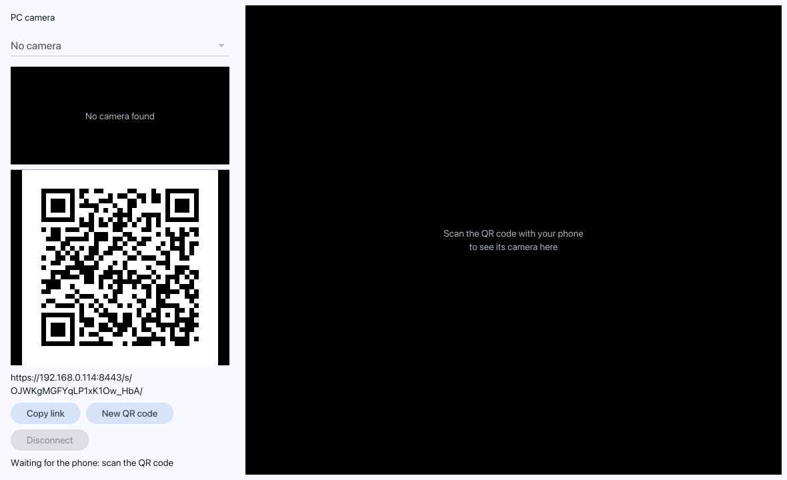

# desktop-mirror

Show your phone's camera on your PC, and your PC's camera on your phone, over WebRTC.

1. Start the desktop app and pick a PC camera.
2. Scan the QR code with your phone and accept the one-time certificate warning.
3. Allow camera access on the phone. Both feeds start.

The app serves the phone page itself over HTTPS on your LAN, so both devices must be on the same network. Nothing leaves your network unless you configure a STUN server.

## macOS

On a Mac the program needs no FFmpeg: the video is H.264 through VideoToolbox and the camera is read through AVFoundation, both part of macOS. It runs on macOS 12 or newer, on Apple silicon and Intel (Glutter 1.16: AppKit and Metal):



```sh
go build -o desktop-mirror ./cmd/desktop-mirror
./desktop-mirror
```

The build needs Go 1.27 and Xcode's command line tools (`xcode-select --install`) for cgo; nothing from Homebrew.

What works on a Mac, said as it was checked:

- **Video codec.** `internal/media/vtbox` encodes and decodes H.264 with VideoToolbox (the Mac's hardware codec when it has one). The peer offers the phone H.264 only (constrained baseline, `packetization-mode=1`), which Safari on iOS and Chrome on Android both have. Checked on the Mac: the encoder and the decoder round trip (VGA, 720p, portrait), and two WebRTC peers exchanging H.264 over loopback through pion's packetizer. **Not checked:** a real phone's browser.
- **The Mac's camera.** `internal/camera` lists the built-in camera, external cameras and an iPhone used as a Continuity Camera, and captures at about 1280x720. macOS asks once whether the program may use the camera. **Not checked:** the Mac the port was made on has no camera, so the listing was run (it found none) and the capture itself was not. `DESKTOP_MIRROR_CAMERA_TEST=1 go test ./internal/camera -run TestCaptureDeliversFrames -v` runs it on a Mac that has one.
- **Without cgo** (`CGO_ENABLED=0`) the program still builds: the window, the QR code and the phone page work, the camera list is empty and no video is sent or decoded (the codec fails with `FFmpegUnavailable`).
- **Network.** The first time the server starts, macOS asks whether the program may accept incoming connections: allow it, or the phone cannot open the page.

## Install the build dependencies (Linux)

You need Go 1.27 or newer, a C toolchain, `pkg-config`, and FFmpeg development files (`libavcodec`, `libavutil`) from an FFmpeg built with libvpx, which provides the VP8 encoder. The UI ([glutter](https://github.com/rm4n0s/glutter)) and the camera capture (Video4Linux2) are pure Go and need no development files, but they need a Wayland or X11 session with OpenGL ES 3.0 or Vulkan at run time, and a camera that Linux exposes as `/dev/video*`.

**Fedora** (the package set the project is developed against):

```
sudo dnf install golang gcc pkgconf-pkg-config \
    libavcodec-free-devel libavutil-free-devel libvpx
```

**Ubuntu / Debian** (package names not tested on this project; the CI workflow installs the same set):

```
sudo apt update
sudo apt install golang-go build-essential pkg-config \
    libavcodec-dev libavutil-dev libvpx-dev
```

**Arch Linux** (package names not tested on this project):

```
sudo pacman -S go base-devel pkgconf \
    ffmpeg libvpx
```

On Arch the `ffmpeg` package already includes the development headers and `libvpx` support. `go.mod` requires Go 1.27. If your distribution's `go` package is older, Go can download the right toolchain itself (`GOTOOLCHAIN=auto`, the default from Go 1.21), or you can install Go from [go.dev/dl](https://go.dev/dl/).

To check that the libraries are found: `pkg-config --modversion libavcodec`. To check the VP8 encoder: `ffmpeg -hide_banner -encoders | grep libvpx`.

## Build and run

```
go build -o desktop-mirror ./cmd/desktop-mirror
./desktop-mirror
```

Flags: `-port` (default 8443), `-udp-min`/`-udp-max` (restrict the WebRTC media ports so a firewall rule can be written), `-stun`, `-config-dir`. Allow the HTTPS port and the UDP range through your firewall if the phone cannot connect.

## Develop

```
go test -race ./...
```

The tests need neither a display nor a camera: the UI tests run on glutter's fake platform, and the camera test skips when there is no camera. See [docs/SPEC.md](docs/SPEC.md) for the design.
